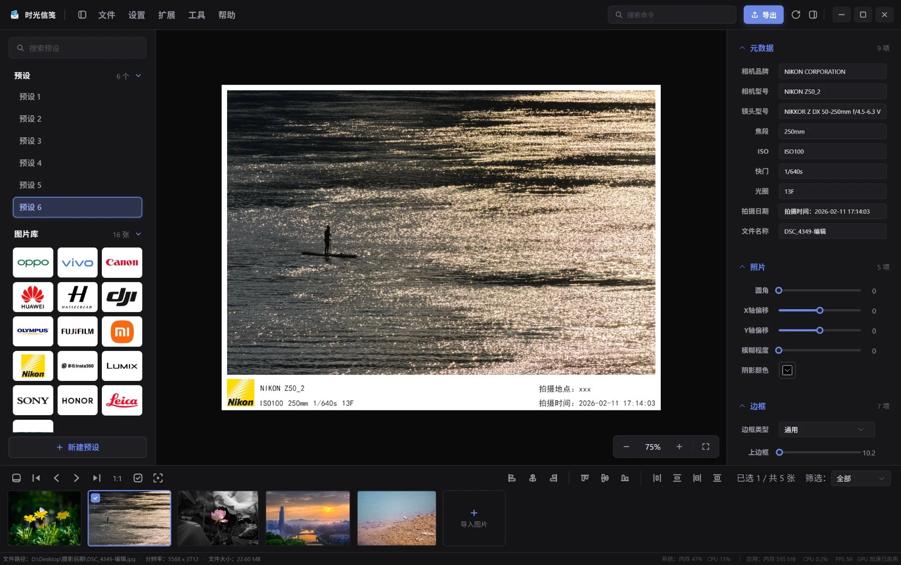

<div align="center">


# 时光信笺 · Time Letter

**一款完全本地运行、无需联网的照片水印边框编辑器 —— 将此刻的记忆封存，寄送给未来的自己**

[](https://gitee.com/geqian618/time-letter/stargazers)
[](https://github.com/geqian618/time-letter/stargazers)
[](https://github.com/geqian618/time-letter/releases)
[](https://github.com/geqian618/time-letter/actions/workflows/build.yml)
[](https://www.electronjs.org/)
[](https://vuejs.org/)
[](https://vitejs.org/)
[](#-跨平台适配与构建)
[](LICENSE)

</div>

---

## 📑 目录

- [📖 项目简介](#-项目简介)
- [🚀 功能特性](#-功能特性)
- [🖼️ 应用预览](#-应用预览)
- [🎬 功能演示](#-功能演示)
- [🛠️ 技术栈](#-技术栈)
- [📁 项目结构](#-项目结构)
- [📥 下载与安装](#-下载与安装)
- [🚀 快速开始（本地开发）](#-快速开始本地开发)
- [⌨️ 键盘快捷键](#-键盘快捷键)
- [📦 打包与跨平台构建](#-打包与跨平台构建)
- [❓ 常见问题](#-常见问题)
- [📜 更新日志](#-更新日志)
- [🤝 贡献指南](#-贡献指南)
- [💝 支持作者](#-支持作者)
- [📄 许可证](#-许可证)

---

## 📖 项目简介

**时光信笺**是一款简单易用、支持高度自定义、不限数量多进程导出、**完全本地运行且无需联网**的照片水印边框编辑器。

> 灵感源自网络上的"埋信仪式"——"寻一块地，埋一封信，寄给若干年后的自己"。将此刻心绪悉心封存，静待时光开启。
>
> 照片亦是如此。如果说书信是写给未来的文字独白，那么照片便是赠予岁月的无声诗篇。
>
> 愿我们都能将转瞬即逝的心绪，凝成一封封穿越时光的无声信笺。待到未来的某日，被你亲手拆开，与曾经的自己，温柔重逢，再忆彼时。

### ✨ 核心优势

- 🖱️ **简单易用** —— 操作逻辑与常见画图软件基本完全一致，零学习成本
- 🧩 **支持高度自定义** —— 自由自定义文本、LOGO、字体、模板预设
- 🚀 **不限数量多进程导出** —— 导出数量不限，多进程并行处理，高效省时
- 📦 **迁移性强** —— 自由导出与导入模板预设、应用全局设置
- 🔒 **本地运行** —— 无需联网、不收集任何数据，隐私安全

---

## 🚀 功能特性

### 🖋️ 水印与文字

- **文本水印**：字体、字号、字重、行高、字间距、列宽、颜色、阴影、旋转、方向（横排 / 竖排）、透明度等全属性可调，支持多行文本
- **EXIF 元数据水印**：一键读取相机品牌、机身、镜头、焦距、ISO、快门、光圈、拍摄时间、文件名并排版成水印，支持等效焦距换算与自定义日期格式
- **LOGO 水印**：内置 16 个相机 / 手机品牌 LOGO（佳能、索尼、尼康、富士、华为、小米、大疆、影石、OPPO、vivo、哈苏、奥林巴斯、松下、荣耀、莱卡、魅族），同时支持自定义图片水印
- **日期水印**：一键添加日期、日期时间模板

### 🖼️ 画布与边框

- **三种边框类型**：纯色（常规）、模糊（照片边缘延伸虚化）、自定义图片，每一边的宽度与颜色均可独立控制
- **照片属性**：圆角、阴影（颜色 / 偏移 / 模糊）、透明度、缩放等
- **专业画布体验**：图层管理、自由拖拽、属性锚点、焦点缩放、移动步长可调，画布对齐参考线与自动吸附，支持撤销与恢复，交互与常见绘图软件保持一致
- **批量处理**：多个画布并行编辑；底部预览面板支持横排 / 竖排筛选、框选多选与快速翻页

### 💾 模板与资源库

- **模板预设**：保存、重命名、启用模板，支持"按数值 / 按比例"同步到多张图片
- **文本库**：集中管理常用水印文案
- **字体库**：导入自定义字体，目录监听自动热加载（内置"字库星球飞扬体"）
- **图片库**：独立窗口的"图片管理器"，集中管理图片素材

### 📤 批量导出

- **多线程导出**：线程数可调，Worker 线程处理，不阻塞 UI，导出任务可取消
- **格式支持**：JPG / JPEG / PNG / WEBP / GIF / AVIF，可保持原格式或指定格式，质量可调
- **输出尺寸**：最佳 / 固定宽度 / 固定高度 / 自适应 四种模式
- **文件命名**：原名 / 序号 / 随机，支持自定义前缀与后缀
- **元数据回写**：可选将 EXIF 元数据同步写入导出图片

### 🧰 应用体验

- 🌗 深色 / 浅色 / 跟随系统主题
- 🌐 中文 / 英文双语界面，跟随系统语言
- 🗂️ 独立窗口的"图片管理器"扩展工具
- 📐 四边面板均可折叠，窗口位置与大小记忆
- 🖱️ 拖拽上传、图片懒加载、系统托盘、原生菜单与快捷键
- 🔒 完全本地、无需联网、零数据收集

---

## 🖼️ 应用预览

<div align="center">
  
  
  
</div>

*主工作区：左侧为预设与图片库，中间为画布编辑区，右侧为属性面板，底部为图片预览栏*

---

## 🎬 功能演示

视频演示与使用教程发布在 B 站：

**[▶️ 点击观看：https://space.bilibili.com/492789742](https://space.bilibili.com/492789742)**

---

## 🛠️ 技术栈

| 类别    | 技术选型                                                  |
| ----- | ----------------------------------------------------- |
| 前端框架  | Vue 3 + Vite 5 + JavaScript                           |
| 状态管理  | Pinia + pinia-plugin-persistedstate（本地持久化）            |
| UI 组件 | Element Plus（unplugin 自动按需引入）                         |
| 国际化   | vue-i18n（中文 / 英文）                                     |
| 桌面端   | Electron 22 + electron-builder                        |
| 图像处理  | sharp（主进程导出）+ @napi-rs/canvas（Node 侧画布渲染）+ Worker 多线程 |
| 元数据   | exiftool-vendored / exif（EXIF 读取与回写）                  |
| 文件监听  | chokidar（图片库 / 字体库热加载）                                |

---

## 📁 项目结构

```
time-letter
├── electron/                     # Electron 主进程
│   ├── main.js                   # 入口文件（窗口 / 菜单 / 托盘 / IPC）
│   ├── preload/                  # 预加载脚本（contextBridge IPC 通道）
│   ├── canvas/                   # Node 侧画布渲染
│   ├── components/               # 原生组件：应用菜单 / 右键菜单 / 托盘 / 文件监听 / 快捷键 / 副窗口
│   ├── thread/                   # Worker 线程：图片导出处理
│   ├── locales/                  # 主进程国际化（原生菜单等）
│   ├── utils/                    # sharp 图像处理 / EXIF / 字体管理 / 路径
│   └── resources/                # 内置资源：应用图标、品牌 LOGO、内置字体
├── scripts/                      # 构建脚本
│   ├── bundle-main.js            # esbuild 打包主进程 / worker / preload
│   └── nsis/                     # NSIS 安装脚本片段
├── src/                          # 渲染进程（Vue 3）
│   ├── views/                    # 页面（主工作区 / 图片管理器扩展）
│   ├── components/               # 面板组件与弹窗
│   ├── canvas/                   # 画布编辑器（渲染进程侧）
│   ├── object/                   # 领域对象：CanvasManager、Configuration 等
│   ├── stores/                   # Pinia 状态（画布 / 模板 / 文本资源 / 设置）
│   ├── composables/              # 组合式函数
│   ├── directive/                # 自定义指令（拖拽排序、输入聚焦）
│   ├── locales/                  # 渲染进程国际化
│   ├── config/                   # 默认配置（配色方案、默认项目设置）
│   └── utils/                    # 工具函数（字体 / 通知 / 节流 / 深拷贝等）
├── electron-builder.json         # 打包配置（Windows: NSIS/zip，macOS: dmg/zip，Linux: AppImage/tar.gz）
├── vite.config.js                # Vite 构建配置
└── package.json
```

---

## 📥 下载与安装

前往 [GitHub Releases](https://github.com/geqian618/time-letter/releases) 或 [Gitee Releases](https://gitee.com/geqian618/time-letter/releases) 下载最新版本（三平台安装包由 GitHub Actions 自动构建）：

| 安装包                                            | 说明                                                                     |
| ---------------------------------------------- | ---------------------------------------------------------------------- |
| `time-letter-x.x.x-win-x64.exe`                | Windows 安装版（NSIS），双击安装，支持自定义安装目录                                       |
| `time-letter-x.x.x-win-x64.zip`                | Windows 便携版，解压即用                                                       |
| `time-letter-x.x.x-x64.dmg / -arm64.dmg`       | macOS 磁盘镜像（Intel / Apple Silicon，必须在 macOS 上构建）                        |
| `time-letter-x.x.x-x86_64.AppImage`            | Linux 免安装包，赋予可执行权限后直接运行                                                |
| `time-letter-x.x.x-x64.tar.gz`                 | Linux 便携版，解压即用                                                         |

---

## 🚀 快速开始（本地开发）

### 环境要求

| 依赖      | 版本                                                                                |
| ------- | --------------------------------------------------------------------------------- |
| Node.js | ≥ 18（推荐 LTS，已在 Node 20 / 22 验证）                                                   |
| npm     | ≥ 9（或 pnpm / yarn）                                                                |
| 操作系统    | Windows / macOS / Linux 均可开发；Windows 与 Linux 产物可在 Windows 构建，macOS 产物必须在 macOS 构建 |

### 开发与构建

```shell
# 1. 克隆仓库（GitHub 主仓库，也可改用 Gitee 镜像）
git clone https://github.com/geqian618/time-letter.git
# git clone https://gitee.com/geqian618/time-letter.git
cd time-letter

# 2. 安装依赖
npm install

# 3. 启动开发模式（Vite + Electron，渲染进程热更新）
npm run electron:serve

# 4. 类型检查 / 代码检查
npm run type-check
npm run lint

# 5. 打包（vite build + electron-builder，默认按当前系统出包）
npm run electron:build

# 6. 指定平台打包（默认按当前系统出包）
npm run electron:build:win
npm run electron:build:linux
npm run electron:build:mac
```

> 打包产物输出到 `output/` 目录。

---

## ⌨️ 键盘快捷键

| 快捷键                | 功能     |
| ------------------ | ------ |
| `Ctrl/⌘ + I`       | 导入图片   |
| `Ctrl/⌘ + O`       | 导出图片   |
| `Ctrl/⌘ + Alt + S` | 打开偏好设置 |
| `Ctrl/⌘ + T`       | 保存为预设 |
| `Ctrl/⌘ + D`       | 移除图片   |
| `Ctrl/⌘ + Alt + D` | 删除图片   |
| `Ctrl/⌘ + L`       | 清空画布   |
| `Ctrl/⌘ + R`       | 重置画布   |
| `Ctrl/⌘ + Z`       | 撤销     |
| `Ctrl/⌘ + Shift + Z` | 恢复   |

> 除撤销 / 恢复外，其余快捷键均可在"偏好设置 → 快捷键"中自定义。

---

## 📦 打包与跨平台构建

### 打包命令

```shell
# 1. 开发：常规启动
npm run electron:serve

# 2. 打包（自动依次执行 vite build → electron-builder 出包）
npm run electron:build

# 3. 指定平台打包（electron-builder 默认按当前系统出包，亦可显式指定）
npm run electron:build:win
npm run electron:build:linux
npm run electron:build:mac
```

### 🌍 跨平台适配与构建

支持 Windows / macOS / Linux。平台差异已在主进程内按 `process.platform` 适配：

| 差异点                          | 适配方式                                                                                                                                                               |
| ---------------------------- | ------------------------------------------------------------------------------------------------------------------------------------------------------------------ |
| 数据目录（模板 / 文本 / 图片与字体资源、浏览器数据） | 开发环境与 Windows 打包沿用应用目录下 `data/`；macOS / Linux 打包使用系统标准用户数据目录（`~/Library/Application Support/时光信笺/data`、`~/.config/时光信笺/data`），因 Finder / AppImage / deb 场景下安装位置不可写。Chromium 配置与缓存单独收敛在 `data/browser/` |
| 配置目录（设置、窗口状态） | 开发环境与 Windows 打包为安装目录下 `config/`（覆盖安装缺省保留）；macOS / Linux 因安装位置可能只读，使用系统标准用户目录下的 `config/` |
| 应用图标                         | Windows 用 `favicon.ico`，macOS / Linux 用 `favicon.png`（icns 由 electron-builder 自动生成）                                                                                |
| 托盘                           | Windows / Linux：常驻菜单 + 左键切换窗口显隐；macOS：左键切换窗口、右键弹菜单（macOS 常驻菜单会吞掉点击事件）                                                                                              |
| 应用菜单                         | macOS 追加 `appMenu` / `editMenu` / `windowMenu` role，否则 Cmd+Q 退出、输入框 Cmd+C/V 复制粘贴不生效                                                                                |
| exiftool 原生依赖                | asar 解包（unpack）规则覆盖全平台二进制包（`exiftool-vendored.*`）                                                                                                                  |

**构建注意事项**：

- macOS 产物未做代码签名（`mac.identity: null`），首次打开需右键 → 打开，或在"系统设置 → 隐私与安全性"中放行。
- Linux 托盘依赖系统 `libappindicator`（Ubuntu 22.04+ 需自行安装 `libayatana-appindicator3-1`）；部分桌面环境不触发托盘 click 事件，菜单仍可用。
- Linux 目标选用 AppImage / tar.gz（免 wine、免 dpkg 工具链）；如需 deb / rpm 建议在 Linux 构建机上追加 target。

---

## ❓ 常见问题

<details>

<summary><b>1. 支持哪些图片格式？</b></summary>

支持 JPG / JPEG / PNG / WEBP / GIF / AVIF 的导入与导出，导出时可保持原格式或指定格式。

</details>

<details>

<summary><b>2. 需要联网吗？会收集我的数据吗？</b></summary>

不需要联网。所有图片处理、水印渲染与导出均在本地完成，不收集、不上传任何数据。

</details>

<details>

<summary><b>3. 支持哪些操作系统？</b></summary>

Windows（NSIS 安装版 + 便携版 zip）、macOS（dmg + zip，Intel / Apple Silicon）与 Linux（AppImage + tar.gz）三平台安装包均由 GitHub Actions 在对应系统上构建，推送 `v*` tag 即自动发布到 Releases：

- 主进程代码已按跨平台编写（数据目录、图标、托盘 / 菜单行为），在各平台构建机上均可直接出包。
- 受 electron-builder 限制，macOS 产物必须在 macOS 上构建（无签名证书时应用可本地运行，但分发需自行处理 Gatekeeper 公证）。
- 构建 macOS 安装包可使用仓库自带的 GitHub Actions 工作流（`.github/workflows/build.yml`）：推送 `v*` tag 或手动触发，即可产出三平台安装包；也可以直接在任何 Mac 上运行 `npm run electron:build`。
- 在 Windows 上构建 Linux AppImage 需开启开发者模式或使用管理员终端（符号链接权限）；deb / rpm 目标依赖 fpm，需在 Linux / macOS 上构建（在 `electron-builder.json` 的 `linux.target` 中追加即可）。
- Windows 便携版数据存储在可执行文件同级 `data/`，设置与窗口状态在同级 `config/`；macOS / Linux 使用系统标准用户数据目录。

</details>

<details>

<summary><b>4. 模板和设置保存在哪里？</b></summary>

全部本地存储。数据目录内含 `templates.json`（模板预设）、`text-resources.json`（文本资源）、`resources/`（图片库）、`fonts/`（字体库）与 `browser/`（Chromium 配置与缓存）；应用设置保存于安装目录 `config/settings.json`，窗口位置与大小记录在 `config/main-window-state.json`。数据目录可直接迁移 / 备份，菜单中也提供模板预设与全局设置的导入 / 导出功能。

</details>

<details>

<summary><b>5. 如何使用自己的字体？</b></summary>

通过"扩展 → 字体库 → 导入字体"添加，或直接将字体文件放入字体资源目录——应用会监听该目录并自动热加载新字体。

</details>

---

## 📜 更新日志

> 完整记录见 <a href="https://github.com/geqian618/time-letter/commits" target="_blank">GitHub 提交历史</a> / <a href="https://gitee.com/geqian618/time-letter/commits" target="_blank">Gitee 提交历史</a>。

### v2.0.1（2026-10 · 当前版本）

**🆕 新增**

- 内置 UI 中文字体，中文界面渲染不再依赖系统字体
- 历史记录撤销与恢复（`Ctrl/⌘ + Z` 撤销、`Ctrl/⌘ + Shift + Z` 恢复）
- 文本库支持配置追加文本是否可编辑

**🐛 修复**

- Windows 产物文件名中文被剥离导致自动更新 404
- 未选中任何图片时仍可触发导出 / 保存预设
- 图片被移除后仍可能因异步加载被渲染

### v2.0.0（2026-08 ~ 2026-10）

**🌟 新增**

- 深色 / 浅色 / 跟随系统主题切换
- 中文 / 英文双语界面，跟随系统语言
- 独立窗口的"图片管理器"扩展工具，集中管理图片素材
- 多行文本水印
- 框选多选元素
- 画布对齐参考线与元素移动自动吸附
- 焦点缩放（以鼠标位置为中心缩放），替代默认的中心缩放
- GIF & AVIF 图片格式支持
- 左 / 右 / 底面板可折叠，底部工具栏缩放，布局更自由
- "重置所有设置"功能
- 检查更新与自动下载安装

**⚡ 优化**

- 底部预览栏改用缩略图，大幅降低加载延迟
- 图片导航改为链表结构，支持跳转首 / 末张
- 图片切换过渡与首次加载性能
- 处理模板预设名称冲突
- 重构数据持久化（Pinia 持久化插件）
- Index.vue 代码重组

**🐛 修复**

- 内存泄漏
- 取消一次导出后，后续导出不可用
- 折叠侧边面板后底部面板无法展开
- 代理类异常

### v1.6.0（2026-07）

- 🆕 引入 Skia 图形渲染器（skia-canvas），升级 Node 侧画布渲染
- 🆕 自定义图片边框：可上传任意图片作为边框素材
- 🆕 PNG 图片元数据读取
- 🆕 预览栏全选按钮
- 🆕 拖拽上传提示
- 🐛 修复过快切换图片时异步调用导致的渲染异常

### v1.5.0（2026-05 ~ 2026-06）

- 🆕 应用配置导入 / 导出，便于多设备迁移
- 🆕 删除的文件移入系统回收站，防止误删
- 🆕 拍摄日期元数据自定义格式化
- 🆕 导入照片数量显示
- ⚡ 未处理的图片导出时直接复制，速度大幅提升
- 🐛 修复属性值精度丢失

### v1.4.0（2026-02 ~ 2026-04）

- 🆕 模板预设导入 / 导出
- 🆕 支持导入 SVG 文件作为水印素材
- 🆕 元数据面板中直接编辑文件名
- 🆕 单实例运行，避免重复启动
- 🆕 预设导出错误提示
- ⚡ 快捷键仅在窗口聚焦时触发，避免与系统快捷键冲突
- ⚡ 默认用户数据存储位置；优化图片库布局与关于页
- 🐛 修复文本编辑时 Ctrl + 大写 A 无法全选、数值改变边框时图片短暂变形

### v1.3.0（2026-01）

- ♻️ 移除 fabric.js，基于 HTML5 Canvas 重建整个项目
- 🆕 导出图片自适应宽 / 高
- 🐛 修复 web / node canvas 渲染不一致、模板同步自定义文本不生效、空格输入无效

### v1.2.0（2025-11 ~ 2025-12）

- 🆕 字体文件导入与字体偏移校正设置
- 🆕 模糊边框
- 🆕 预览图片缩放；悬停显示图片信息
- 🆕 导出时同步原图元数据开关
- 🆕 空格 + 鼠标拖拽平移画布；拖拽上传图片
- 🆕 导出文件重命名（前缀 / 后缀）；全局画布缩放配置
- 🆕 方向键移动元素；自定义滚动条样式
- ⚡ 事件性能优化、文本编辑体验改进、大规模代码重构

### v1.1.0（2025-09 ~ 2025-10）

- 🆕 等效焦距换算与自定义转换系数
- 🆕 下载线程数设置与导出任务取消
- 🆕 上 / 下一张图片导航菜单；竖排文字布局
- ⚡ 设置窗口标签切换体验、滑块组件扩展、UI 细节打磨

### v1.0.0（2025-08 · 首个版本）

- 🎉 项目立项：照片导入与原图预览、自适应水印排版
- 🆕 文本 / 日期 / EXIF 元数据水印，支持拖拽定位与同步
- 🆕 初始模板预设功能
- 🆕 图片 / 文字阴影与图层控制
- 🆕 导出全局配置、尺寸选项、字体样式与字重设置
- 🆕 关于页、配置同步定位模式

---

## 🤝 贡献指南

欢迎提交 Issue 和 Pull Request：

```shell
# 1. Fork 本仓库并克隆到本地
# 2. 创建功能分支
git checkout -b feature/your-feature

# 3. 提交修改
git commit -m "feat: add your feature"

# 4. 推送并发起 Pull Request
git push origin feature/your-feature
```

---

## 💝 支持作者

如果这个项目对你有帮助，欢迎来 [B 站](https://space.bilibili.com/492789742) 关注我，也欢迎请作者喝杯咖啡 ~

<div align="center">
  
  &nbsp;&nbsp;&nbsp;&nbsp;
  
</div>

---

## 📄 许可证

本项目基于 [GNU General Public License v3.0](LICENSE) 开源 —— Copyright © 2025 秋风吹落了秋枫。

你可以自由地使用、修改和分发本软件，包括商用；但分发修改后的版本时，必须以 GPL-3.0 同协议开源并提供完整源代码，同时保留原版权与许可声明。个人使用与内部使用不受限制。软件按“原样”提供，作者不承担任何担保责任。

---

<div align="center">

**愿每一张照片，都成为一封寄往未来的信笺。** ⏳

<sub>Made with ❤️ by 秋风吹落了秋枫</sub>

</div>
